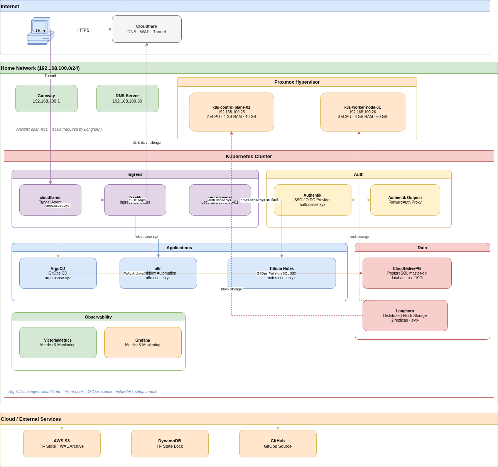

# homelab

A self-hosted Kubernetes platform running on bare metal Proxmox, managed entirely as code — Terraform provisions the VMs, Ansible bootstraps the OS layer, and ArgoCD keeps the cluster in sync with this repo.

Public services are exposed at **osose.xyz** via a Cloudflare tunnel. No ports are open on the router.

---

## Architecture



---

## Stack

| Layer | Technology |
|---|---|
| Hypervisor | Proxmox VE |
| IaC | Terraform (Telmate/proxmox provider) |
| Configuration management | Ansible |
| Kubernetes distribution | k3s |
| GitOps | ArgoCD |
| Ingress | Traefik |
| TLS | cert-manager + Let's Encrypt (DNS-01 via Cloudflare) |
| External access | Cloudflare Tunnel (`cloudflared`) |
| Identity / SSO | Authentik (OIDC provider for ArgoCD, Grafana, and app routes) |
| Storage | Longhorn (distributed block storage, 2 replicas) |
| Database | CloudNativePG (PostgreSQL operator) |
| DB backups | Barman Cloud Plugin → S3 + daily `ScheduledBackup` |
| Observability | VictoriaMetrics stack (VMSingle, VMAgent, VMAlert, Grafana, Alertmanager) |
| Logging | Fluent Bit → VictoriaLogs |

---

## Repository Layout

```
homelab/
├── terraform/
│   ├── proxmox/            # Root module: the 4 k3s VMs, defined in terraform.tfvars
│   └── modules/k8s-vm/     # Shared VM module (for_each over the vms map)
├── ansible/
│   ├── inventory/          # Static inventory + Proxmox dynamic inventory
│   ├── playbooks/          # install-deps.yml, join-k3s-worker.yml, upgrade-k3s.yml
│   └── roles/              # k3s-worker, k3s-upgrade
├── k8s/
│   ├── argo-apps/          # ArgoCD Application CRDs (one file per app)
│   ├── charts/
│   │   └── values/         # Helm value overrides per release
│   └── manifest/
│       ├── apps/           # Jellyfin media stack, landing page
│       ├── auth/           # Authentik proxy outpost, Traefik ForwardAuth middleware
│       ├── cnpg/           # CloudNativePG Cluster, ObjectStores, ScheduledBackup
│       ├── monitoring/     # Alertmanager routes
│       └── wordpress/      # WordPress + MariaDB + Redis, with Apache hardening
└── docs/                   # Runbooks and incident write-ups
```

---

## Interesting Details

### Zero open ports
All inbound traffic flows through a Cloudflare Tunnel running as a Kubernetes `DaemonSet` (one connector per node). The tunnel process dials out to Cloudflare — no firewall rules needed, no ports forwarded. Adding a new public hostname is a one-line YAML change to the ConfigMap in `k8s/manifest/cloudflared/cloudflared.yaml`; ArgoCD auto-syncs it within seconds.

### SSO on everything
Authentik is the identity provider. ArgoCD and Grafana use native OIDC (`role:admin` and `Admin` are granted to members of their respective Authentik groups). An Authentik proxy outpost and a Traefik `ForwardAuth` middleware are available for apps that have no login of their own.

### GitOps with ArgoCD multi-source
The `monitoring`, `victoria-logs` and `fluent-bit` ArgoCD Applications use the multi-source pattern: the Helm chart is pulled from its upstream registry, while the value overrides come from this Git repo. This means the chart version can be pinned and bumped in code, and value drift is impossible — the cluster always reflects what's in `main`.

### Database operator with WAL archiving
CloudNativePG manages a single-instance PostgreSQL cluster. Every WAL segment is shipped to S3 via the Barman Cloud Plugin, providing continuous archiving on top of the daily `ScheduledBackup`. Recovery bootstraps from the latest base backup and replays WAL — point-in-time recovery is available without any manual snapshot orchestration.

### Longhorn storage classes
Two StorageClasses (`longhorn-delete` / `longhorn-retain`) with different reclaim policies separate ephemeral workloads from production data. The `longhorn-retain` class is used for the CNPG cluster, Grafana, VictoriaMetrics, VictoriaLogs and the app data volumes — a `kubectl delete pvc` on those workloads won't destroy the underlying volume.

### Metrics and logs in one place
VMAgent scrapes the kubelet/cAdvisor, node-exporter and kube-state-metrics into VMSingle, and Fluent Bit ships every container's logs to VictoriaLogs. Grafana reads both, so a memory spike and the log lines that caused it sit side by side. VMAlert evaluates the alert rules and Alertmanager routes them.

---

## Services

| Service | URL | Auth |
|---|---|---|
| ArgoCD | argo.osose.xyz | Authentik OIDC |
| Authentik | auth.osose.xyz | — |
| Grafana | grafana.osose.xyz | Authentik OIDC |
| Jellyfin | jellyfin.osose.xyz | Jellyfin accounts |

---

## Docs

Operational runbooks live in [`docs/`](docs/):

- [`cnpg-s3-backup-restore.md`](docs/cnpg-s3-backup-restore.md) — CNPG backup/restore procedures with Barman Cloud Plugin
- [`cnpg-storage-migration.md`](docs/cnpg-storage-migration.md) — migrating the database cluster between StorageClasses
- [`db-query-troubleshooting.md`](docs/db-query-troubleshooting.md) — PostgreSQL slow query analysis with `pg_stat_statements` and `EXPLAIN ANALYZE`
- [`monitoring-stack-plan.md`](docs/monitoring-stack-plan.md) — VictoriaMetrics + Grafana + Alertmanager deployment reference
- [`log-collection-plan.md`](docs/log-collection-plan.md) — Fluent Bit → VictoriaLogs design
- [`trilium-notes.md`](docs/trilium-notes.md) — Trilium deployment guide (decommissioned)
- [`remove-vm.md`](docs/remove-vm.md) — safe VM decommission procedure (Terraform + monitoring cleanup)

Incident write-ups: [CNPG WAL disk full](docs/cnpg-wal-disk-full-incident.md), [worker-2 NIC failure](docs/worker-2-nic-failure.md), [Pi-hole DNS outage](docs/pihole-dns-outage-nic-hang.md), [Authentik task index corruption](docs/authentik-task-index-corruption-incident.md), [WordPress compromise](docs/wordpress-compromise-2026-10-incident.md).
